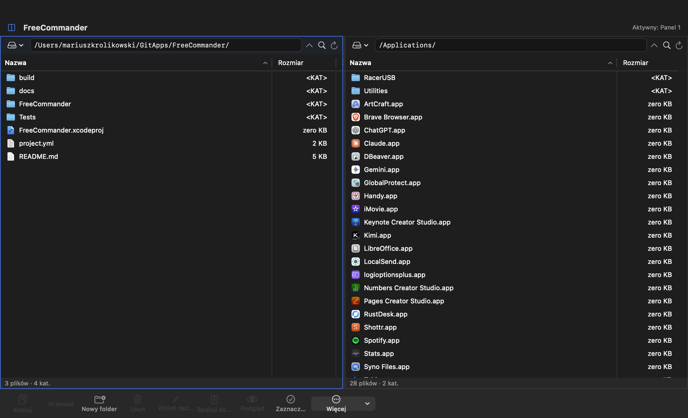

# FreeCommander (macOS)

Darmowy, dwupanelowy menedżer plików na macOS w duchu **Total Commandera**:
dwa panele obok siebie, klawisze F5/F6/F7/F8, zaznaczanie, kopiowanie i przenoszenie
między panelami, ZIP, Quick Look, Kosz. Aplikacja **nie jest sandboxowana**, więc widzi
cały dysk — jak Total Commander na Windows.



## Funkcje (v0.1)

- **Dwa niezależne panele** z pełnym dostępem do systemu plików (piaskownica wyłączona).
  Kliknięcie panelu (albo zmiana zaznaczenia w nim) aktywuje go — operacje idą
  **z aktywnego panelu do drugiego**. U góry widać „Aktywny: Panel N".
- **Klawisze jak w Total Commanderze** (globalnie w oknie, poza edycją pól tekstowych):
  | Klawisz | Akcja |
  |---|---|
  | F5 | kopiuj zaznaczenie do drugiego panelu |
  | F6 | przenieś zaznaczenie do drugiego panelu |
  | F7 | nowy folder |
  | F8 | usuń (do Kosza lub trwale — dialog) |
  | F2 | zmień nazwę |
  | Tab | przełącz aktywny panel |
  | Enter | otwórz (katalog wejdź / plik domyślną aplikacją) |
  | Backspace | poziom wyżej |
  | Space | podgląd Quick Look |
  | Cmd+A | zaznacz wszystko |
  | Cmd+Shift+. | pokaż/ukryj pliki ukryte |
- **Natywna tabela plików (NSTableView)**: wielokrotne zaznaczanie cmd/shift, dwuklik
  otwiera, kliknięcie nagłówka sortuje (Nazwa/Rozmiar/Data), ikony plików jak w Finderze,
  sortowanie „katalogi najpierw", stabilny remis po nazwie.
- **Menu kontekstowe** (prawy przycisk): otwórz, podgląd, Pokaż w Finderze, kopiuj/przenieś
  do drugiego panelu, zmień nazwę, duplikuj, informacje, spakuj/rozpakuj, Kosz, usuń trwale.
- **Operacje wsadowe z postępem**: kopiowanie/przenoszenie/usuwanie item-po-itemie
  z licznikiem, konflikty nazw rozwiązane automatycznie („nazwa (2).ext"),
  blokada przenoszenia folderu do jego własnego podfolderu.
- **ZIP** (ZIPFoundation): pakowanie zaznaczenia (wiele elementów → folder-koperta w archiwum),
  rozpakowywanie. **Kosz** domyślnie, usuwanie trwałe na życzenie.
- **Belka ścieżki**: edytowalna ścieżka (Return = przejdź, obsługa `~`), menu Ulubione
  (Dom, Dysk startowy, Aplikacje, Pulpit, Dokumenty, Pobrane) i **Woluminy** (dyski montowane).
- **Podgląd Quick Look** (ten sam silnik co spacja w Finderze), Informacje o pliku
  (rozmiar folderu liczony rekursywnie, daty, ścieżka).
- **Filtr** bieżącego katalogu, paski statusu paneli („N plików · M kat.", zaznaczenie + rozmiar).
- Stan paneli, sortowanie i ukryte pliki zapamiętywane między uruchomieniami. Języki: **PL + EN**.

## Budowanie i uruchamianie

Wymagany Xcode (projekt generowany z [xcodegen](https://github.com/yonaskolb/XcodeGen)):

```bash
brew install xcodegen
xcodegen generate                      # tworzy FreeCommander.xcodeproj z project.yml
open FreeCommander.xcodeproj           # w Xcode: ⌘R
```

Build i testy z CLI:

```bash
xcodebuild -project FreeCommander.xcodeproj -scheme FreeCommander \
  -destination 'platform=macOS,arch=arm64' -derivedDataPath build/DerivedData build

xcodebuild -project FreeCommander.xcodeproj -scheme FreeCommander \
  -destination 'platform=macOS,arch=arm64' -derivedDataPath build/DerivedData test
```

Szybkie uruchomienie zbudowanej aplikacji:

```bash
open build/DerivedData/Build/Products/Debug/FreeCommander.app
```

Aplikacja podpisana ad-hoc lokalnie (bez konta dewelopera). `--fc-snapshot <ścieżka>`
to ukryty tryb weryfikacyjny: renderuje okno do PNG i kończy działanie.

## Architektura

```
FreeCommander/
  App/          FreeCommanderApp (punkt wejścia + tryb snapshotu, menu Commands)
  Models/       FileItem, SortField/Direction, FavoriteLocation/SystemLocations
  Services/     FileSystemService (lista/operacje/ZIP/Kosz), SettingsStore,
                OperationsEngine (operacje wsadowe z postępem, poza wątkiem głównym)
  ViewModels/   PaneViewModel — stan panelu: katalog, zawartość, zaznaczenie,
                sort, filtr, żądania dialogów (podgląd/info/rename/delete)
  Views/        ContentView (układ 2-panelowy + router komend), FilePaneView
                (belka ścieżki + status), FileListView (NSTableView: zaznaczanie,
                dwuklik, sortowanie nagłówkami, menu kontekstowe), BottomActionBar,
                InfoSheet, QuickLookView, CommandRouter + KeyboardMonitor (F-klawisze)
  Resources/    pl.lproj / en.lproj (Localizable.strings)
Tests/          15 testów jednostkowych rdzenia (listy, sortowanie, operacje, ZIP, rozmiary)
```

Zależność zewnętrzna: [ZIPFoundation](https://github.com/weichsel/ZIPFoundation) (MIT).

## Mapa drogowa

- [ ] Widok drzewa katalogów / zakładki użytkownika (zapisane ścieżki)
- [ ] Porównywanie paneli (sync katalogów jak w TC), wybór trybu konfliktów (nadpisz/pomiń)
- [ ] Edytor tekstu (F4), wiersz poleceń z `%!` jak w TC
- [ ] Archiwa 7z/RAR (odczyt), tar.gz
- [ ] Drag & drop między panelami i z Findera, schowek na wycięte pliki
- [ ] Rozmiary pakietów .app (teraz „zero KB"), atrybuty uprawnień w Informacjach
- [ ] Motyw jasny/ciemny w stylu TC, konfigurowalne kolumny

## Wersja iOS

Pierwotny prototyp na iOS/iPadOS (sandbox, security-scoped bookmarks) jest zachowany
na gałęzi [`ios-mvp`](https://github.com/) w tym repozytorium.
