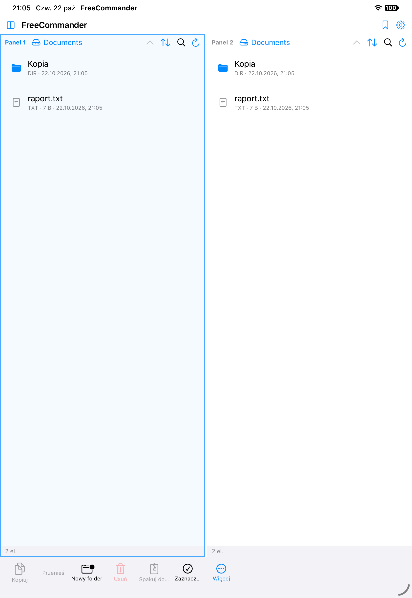

# FreeCommander (iOS)

Darmowy, dwupanelowy menedżer plików na iPhone'a i iPada w duchu **Total Commandera**:
dwa panele, zaznaczanie, kopiowanie/przenoszenie między panelami, ZIP, podgląd QuickLook.



## Funkcje (v0.1)

- **Dwa panele** jak w Total Commanderze: iPad — obok siebie, iPhone — przełącznik „Panel 1 / Panel 2".
  Kliknięcie panelu aktywuje go (niebieska ramka); operacje działają **z aktywnego panelu do drugiego**.
- **Operacje**: kopiuj, przenieś, usuń (z potwierdzeniem), zmień nazwę, duplikuj, nowy folder,
  nowy plik tekstowy, zaznacz wszystko/odznacz.
- **ZIP**: spakuj zaznaczenie (ZIPFoundation), rozpakuj archiwum `.zip`.
- **Nawigacja**: poziom wyżej, lista lokalizacji (zakładki), sortowanie (nazwa/data/rozmiar/typ, rosnąco/malejąco,
  katalogi najpierw), filtr bieżącego katalogu, ukryte pliki (ustawienie).
- **Podgląd**: QuickLook po kliknięciu pliku; Udostępnij (sheet) z menu kontekstowego.
- **Informacje o pliku**: rozmiar (dla folderów — liczony rekursywnie), daty, ścieżka, liczba elementów.
- **Zakładki z aplikacji Pliki** (security-scoped bookmarks) — np. iCloud Drive, pamięć zewnętrzna.
- **Katalog Dokumenty aplikacji jest widoczny w aplikacji Pliki** (`UIFileSharingEnabled`) — także w Finderze
  po podłączeniu kabla („Udostępnianie plików").
- Języki: polski i angielski (`Localizable.strings`).

## Ograniczenie iOS (ważne!)

iOS jest silnie odseparowany (sandbox) — **aplikacja nie może przeglądać całego systemu plików urządzenia**
jak Total Commander na Windowsie czy Androidzie. Źródła plików, które pozostają:

1. katalog Dokumenty aplikacji (pełny odczyt/zapis, widoczny w Plikach i Finderze),
2. katalogi udostępniane przez aplikację Pliki dodane jako zakładki (iCloud Drive, dostawcy zewnętrzni, USB/SMB w Plikach),
3. pliki przekazane przez „Udostępnij → Zapisz do plików" lub AirDrop,
4. w przyszłości: własne implementacje sieciowe (SMB/FTP/SFTP/WebDAV) — patrz mapa drogowa.

## Budowanie i uruchamianie

Wymagany Xcode (projekt generowany przez [xcodegen](https://github.com/yonaskolb/XcodeGen)):

```bash
brew install xcodegen
xcodegen generate                      # tworzy FreeCommander.xcodeproj z project.yml
open FreeCommander.xcodeproj           # w Xcode: ⌘R na symulatorze
```

Build z CLI (symulator):

```bash
xcodebuild -project FreeCommander.xcodeproj -scheme FreeCommander \
  -destination 'platform=iOS Simulator,name=iPhone 17' \
  -derivedDataPath build/DerivedData build CODE_SIGNING_ALLOWED=NO
```

### Uruchomienie na prawdziwym urządzeniu (za darmo)

1. Podłącz iPhone'a/iPada kablem, w Xcode wybierz urządzenie jako destination.
2. `Signing & Capabilities` → wybierz swój **Personal Team** (darmowe konto Apple ID wystarczy).
3. Na urządzeniu: Ustawienia → Ogólne → VPN i zarządzanie urządzeniami → zaufaj certyfikatowi.
4. ⌘R. Aplikacja darmowego konta wygasa po **7 dniach** — wystarczy ponownie zbudować z Xcode.

## Architektura

```
FreeCommander/
  App/          FreeCommanderApp (punkt wejścia)
  Models/       FileItem, SortField/Direction, PaneLocation (documents/temporary/bookmark)
  Services/     FileSystemService (lista/operacje/ZIP), BookmarkStore (security-scoped
                bookmarks), ScopeAccess (licznik start/stopAccessing), SettingsStore,
                OperationsEngine (operacje wsadowe z postępem, poza wątkiem głównym)
  ViewModels/   PaneViewModel — stan panelu: katalog, zawartość, zaznaczenie, sort, filtr
  Views/        ContentView (układ 2-panelowy), FilePaneView, FileRowView,
                BottomActionBar (pasek F-klawiszy TC), RootsSheet, SettingsSheet,
                InfoSheet, Representables (ShareSheet, FolderPicker)
  Resources/    pl.lproj / en.lproj (Localizable.strings)
```

Zależność zewnętrzna: [ZIPFoundation](https://github.com/weichsel/ZIPFoundation) (MIT) — tylko do ZIP.
Stan paneli, sortowanie i zakładki są zapamiętywane w `UserDefaults`.

## Mapa drogowa

- [ ] Sieć: SMB (SMBClient), SFTP, FTP, WebDAV przez URLSession — własne „drzewo" lokalizacji
- [ ] Archiwa: 7z/RAR (odczyt), opcje konfliktów (nadpisz/pomiń/zmień nazwę)
- [ ] Wbudowany edytor tekstu
- [ ] Skróty klawiatury sprzętowej na iPada (F5=kopiuj, F6=przenieś, F7=nowy folder, F8=usuń)
- [ ] Porównywanie paneli (sync katalogów), wątki operacji w tle z anulowaniem
- [ ] Ikona aplikacji, motyw ciemny/jasny w stylu TC

## Nazwa

„FreeCommander" to robocza nazwa (istnieje też produkt FreeCommander na Windows).
Zmiana nazwy = jedno pole w `project.yml` (`name`, `CFBundleDisplayName`) + `xcodegen generate`.
